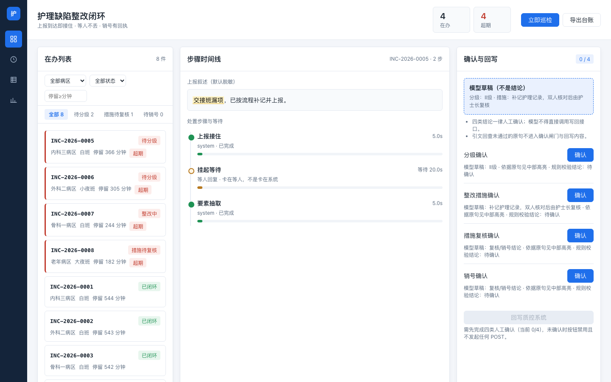
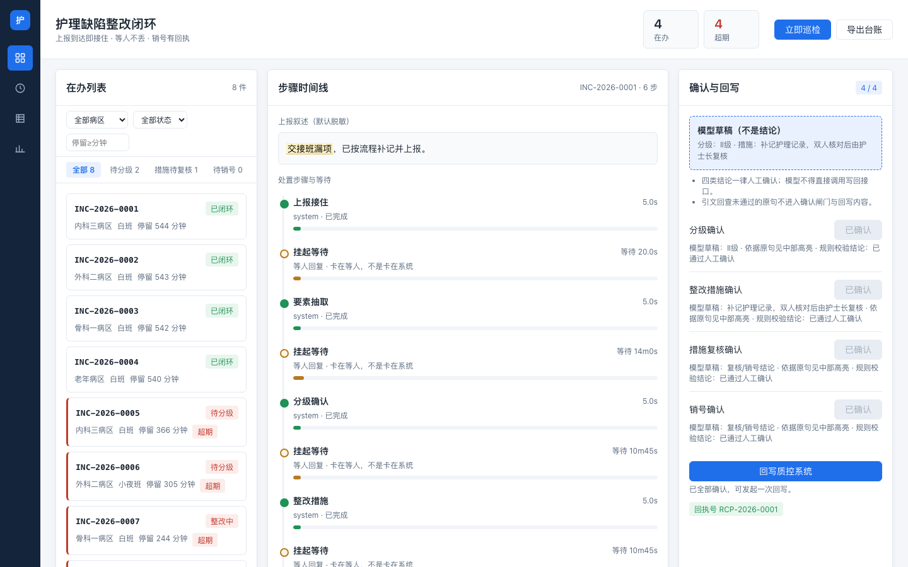
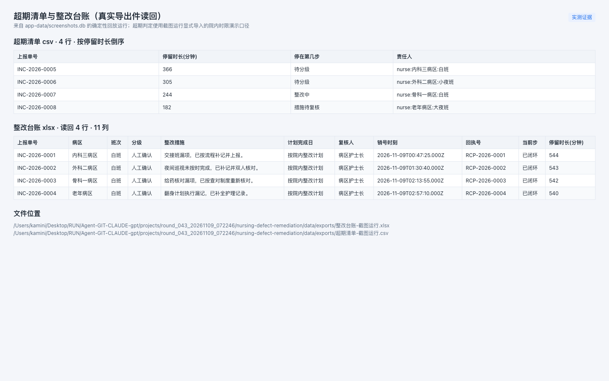
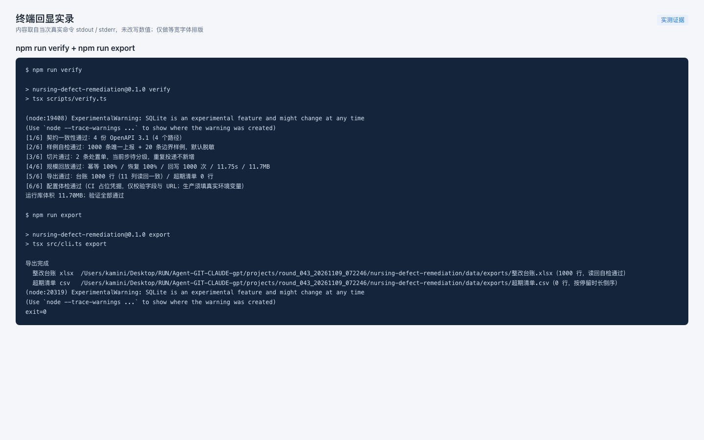

# 护理缺陷整改闭环系统

> 护理部每天收到新的护理缺陷上报后，这条单子停在「待分级」多久、催过几次、谁在等谁、销号回执有没有对上——系统替你记着；窗口里直接看到在办清单与步骤时间线，人工确认后一次性回写质控系统并带回执号。

护理不良事件上报系统只管「报上来」，报完之后那段路——分级、整改措施、复核、销号、回写——通常散落在微信群、Excel 台账和几个人的记忆里。本产品接管的就是**上报之后**的处置段：它常驻在护理部办公电脑上，自己去拉新上报、把每一件拆成有名字的步骤、卡在等人回复时就**挂起**并记住等了多久、跨天和关机都不丢，最后在窗口里给出可核对的整改台账。模型只负责把护理员用大白话写的缺陷描述归并成统一的缺陷类型和要素；**分级、措施、复核、销号四个结论一律由人确认**后才算数，系统不替护理部下结论、不替人签字。

## 适用场景 / 目标岗位

| 岗位 | 什么时候用 | 得到什么 |
|------|------------|----------|
| 护理部质控员 | 每天早上打开电脑，想知道昨天以来的上报现在走到哪一步 | 一张在办清单：每件的上报单号、病区、当前步、停留多久、是否超期，不用再翻上报系统 + Excel |
| 病区护士长 | 收到一条待分级的护理缺陷单，需要给出分级和整改措施 | 一份**草稿**（缺陷类型归并 + 要素表 + 建议措施）加上依据原句，逐条确认后才进入下一步 |
| 病区护理组长 | 措施写完，要复核这条整改是否落到实处 | 复核确认项 + 该件从上报到现在的完整时间线，看得出到底卡在哪一步 |
| 护理部主任 | 每周科务会要一份整改台账和超期情况 | 一份 xlsx 整改台账（含销号回执号）和一份按停留时长倒序的超期清单，直接发群里 |

## 能力要点

- **新上报两分钟内进窗口**：系统按 60 秒节奏轮询上报系统，收到即建处置单并出现在「在办」列表，同一条上报重复投递也只会有一条处置单。
- **等人不丢、计时不断**：处置单停在「待分级」时挂起项独立落库，进程重启、机器休眠、跨天都不会重置停留时长，卡在等人还是卡在系统一眼能分。
- **每天早上自动点名超期**：每日 08:00 巡检按停留时长倒序找出超期件，推送到科室企微群；同一条同一批次只催一次，不刷屏。
- **回写恰好一次，人工确认才算数**：分级、措施、复核、销号四类结论都要人在窗口里确认；确认后带幂等键回写质控系统，拿到回执号，窗口和导出台账是同一个数据源。
- **模型不可达时不瞎猜**：模型调不通就降级为规则粗分级，处置单**停在当前步不推进、不回写、不销号**，窗口明说「模型不可达，已用规则初判，待人工确认」。
- **每一步都有据可查**：从上报到销号，每一步谁在什么时候做的、改了哪一步，全部只增不改地留痕，回答「这件为什么停了三天」不用再靠回忆。

## 快速开始

### 依赖

| 项 | 版本 | 说明 |
|----|------|------|
| Node.js | ≥ 20 | 桌面窗口与命令行通道共用一套运行时 |
| 操作系统 | Windows 为主，兼容 macOS | 护理部办公电脑的常见环境 |
| 磁盘 | ≤ 200 MB | 运行态是单个 SQLite 文件 |

### 安装

```bash
git clone <本仓库地址>
cd nursing-defect-remediation
npm ci
```

### 配置

凭据一律从**环境变量**读，代码里不存任何密钥。复制模板后按院内实际地址填写：

```bash
cp .env.example .env
```

Windows 上用系统环境变量或 PowerShell 设置（其余变量同理，见 `.env.example`）：

```powershell
$env:NURSING_QC_BASE_URL = "https://nursing-qc.院内域名"
$env:NURSING_QC_TOKEN    = "<质控系统接口令牌>"
$env:EMR_BASE_URL        = "https://emr.院内域名"
# 其余变量同理，见 .env.example
```

必填项缺任何一个，程序启动即报错并**点名缺失的变量名**（如 `MISSING ENV: NURSING_QC_TOKEN`），
不会出现「连上了但悄悄是别的端点」的情况。

### 构建与验证

```bash
# 类型检查 + 全量单测；再跑一次配置体检
npm test && npm run doctor
```

### 主命令速查

```bash
npm run doctor      # 校验配置与凭据位，打印脱敏摘要（排障第一道）
npm run dev         # 启动桌面常驻应用（托盘 + 窗口）
npm run replay -- --input data/raw/incidents.jsonl   # 规模回放：幂等命中率与恢复正确率
npm run export      # 导出整改台账 xlsx 与超期清单 csv
```

日常使用入口是**桌面窗口**；上面这些命令是运维与排障通道（后台跑批、CI、无人值守场景）。

## 命令 / API / 配置说明

### 关键配置项

| 配置项 | 默认值 | 必填 | 说明 |
|--------|--------|------|------|
| `NURSING_QC_BASE_URL` | — | 必填 | 护理质控上报系统基地址（读上报 + 回写整改结论） |
| `NURSING_QC_TOKEN` | — | 必填 | 质控系统接口令牌，出站请求头 `Authorization: Bearer <token>` |
| `EMR_BASE_URL` | — | 必填 | 电子病历基地址（读护理记录） |
| `EMR_API_TOKEN` | — | 必填 | 电子病历接口令牌 |
| `WECOM_WEBHOOK_URL` | — | 必填 | 科室企微群机器人地址（超期催办） |
| `MODEL_BASE_URL` | — | 必填 | 模型服务基地址，院内自建端点或云服务均可 |
| `MODEL_API_KEY` | — | 必填 | 模型服务密钥 |
| `MODEL_NAME` | `gpt-4o-mini` | 选填 | 模型名 |
| `MODEL_TIMEOUT` | `30000`（毫秒） | 选填 | 单次模型调用超时；**非法值自动回落默认**并在运行摘要标注 |
| `MODEL_MAX_RETRIES` | `2` | 选填 | 模型调用最大重试次数 |
| `MODEL_TEMPERATURE` | `0.2` | 选填 | 采样温度 |
| `POLL_INTERVAL_SEC` | `60` | 选填 | 上报轮询间隔（秒） |
| `DAILY_SWEEP_AT` | `08:00` | 选填 | 每日超期巡检时刻（`HH:mm`）；格式非法自动回落默认 |

### CLI 子命令 / 接口端点

| 命令或路径 | 用途 | 关键参数 |
|------------|------|----------|
| `npm run doctor` | 校验必填凭据与端点，打印脱敏生效配置 | — |
| `npm run dev` | 启动桌面常驻应用（托盘 + 窗口） | — |
| `npm run replay` | 规模回放并打印幂等命中率 / 恢复正确率 / 耗时 / 体积 | `--input <jsonl>` |
| `npm run export` | 导出整改台账 xlsx 与超期清单 csv | `--out <目录>` |
| `GET {NURSING_QC_BASE_URL}/api/v1/nursing-incidents` | 入站读：拉取新上报（分页 + 增量水位） | `status`、`limit`、`since` |
| `GET {EMR_BASE_URL}/api/v1/nursing-records` | 入站读：按住院号查护理记录 | `encounter_id` |
| `POST {NURSING_QC_BASE_URL}/api/v1/nursing-incidents/{incident_id}/review` | 出站写：回写整改结论 | 头 `idempotency-key`；体含 `review_result` / `grade` / `remediation_plan` / `plan_deadline` / `evidence_refs[]` / `revision` |
| `POST {WECOM_WEBHOOK_URL}` | 出站写：超期催办推送（markdown） | `msgtype=markdown` |
| `POST {MODEL_BASE_URL}/v1/chat/completions` | 出站写：要素抽取 / 分级建议 / 措施草稿 | `messages`、`temperature`、`response_format` |

四条院内协议的完整字段规范以 **OpenAPI 3.1 契约文件**落盘在 `docs/api/`，供信息科逐条核对；
契约与代码字段不一致时校验脚本会直接失败，不允许「文档一套、代码另一套」。

### 错误与降级

| 场景 | 表现 | 处理方式 |
|------|------|----------|
| 必填凭据缺失 / 端点非法 | 启动即失败，`MISSING ENV: <变量名>` 或 `INVALID ENV: <变量名>` | 按提示补齐环境变量或修正地址后重启；不会带着空凭据半启动 |
| 模型服务不可达 / 超时 | 窗口提示「模型不可达，已用规则初判，待人工确认」 | 退避重试 ≤2 次后**降级为规则粗分级**；处置单停在当前步，**不推进、不回写、不销号** |
| 模型返回结构不符合约定 | 该步停在原地，不生成草稿 | 按协议错误处理并记审计，人工可手工补录 |
| 质控系统返回 4xx | 该件停在当前步，不重试 | 按永久失败处理，窗口显示失败原因，请人核对数据 |
| 质控系统返回 5xx / 网络错 | 退避重试（上限来自配置，默认 3 次） | 重试耗尽后停在当前步，窗口显示已重试次数 |
| 回写时版本冲突（revision 不符） | 按 409 处理，不静默重试 | 提示人工到质控系统核对最新版本后重提 |
| 企微推送失败 | 记审计，**不阻断**主处置流程 | 次日巡检仍会重新判定是否需要再推 |
| 上报里缺住院号 | 该件进「住院号核对」清单 | **不猜、不补、不报错**，也不会去查 EMR |
| 制度时限未导入 | 界面显示「未设定时限」 | 不按自造数字催办，该件不参与超期判定 |

### 对接现有系统

| 对端 | 方向 | 协议 | 凭据来源 | 脱敏替身 |
|------|------|------|----------|----------|
| 护理质控上报系统 | 读 + 写 | HTTPS / JSON | `NURSING_QC_BASE_URL`、`NURSING_QC_TOKEN` | 只在测试目录出现 |
| 电子病历 EMR | 读 | HTTPS / JSON | `EMR_BASE_URL`、`EMR_API_TOKEN` | 只在测试目录出现 |
| 企业微信群机器人 | 写 | HTTPS / JSON（markdown） | `WECOM_WEBHOOK_URL` | 只在测试目录出现 |
| 模型服务（OpenAI-compatible） | 写 | HTTPS / JSON | `MODEL_BASE_URL`、`MODEL_API_KEY` | 只在测试目录出现 |

产品代码里**没有任何指向示例地址或本地替身的默认值**，凭据位只从环境变量读；测试目录中的本地替身只用于协议兼容性验证，不代表最终对接方式。

## 典型场景

### 场景 1：护理部质控员早上打开电脑，先看今天有什么压在手里

1. 双击打开桌面应用，窗口自动常驻托盘；左栏「在办」列表按状态分栏显示昨天以来的所有处置单。
2. 页头两个数字：**在办 N** / **超期 M**——超期用红色标签，一眼看出该先管哪些。
3. 点「立即巡检」手动拉一次；平时系统每 60 秒自己拉，不用等。

```bash
# 排障等价命令：手动拉一次并看配置是否正常
npm run doctor
```

### 场景 2：护士长给一条待分级的缺陷单定级、给出整改措施

1. 左栏找到本病区的待分级卡片，右侧显示系统给出的**草稿**：归并后的缺陷类型、要素表、建议分级与整改措施。
2. 草稿里每条要素都带**依据原句**——叙述中被高亮的那句原文就是出处；对不上原文的引用会被标红作废，不进入确认项。
3. 护士长改完、确认后，处置单推进到「措施待复核」；**确认之前不会向质控系统发任何请求**。

```bash
# 回写发生在人工确认之后，且带幂等键只发一次
# curl -X POST "$NURSING_QC_BASE_URL/api/v1/nursing-incidents/<上报单号>/review" \
#   -H "idempotency-key: <幂等键>" -H "Authorization: Bearer $NURSING_QC_TOKEN" -d '{...}'
```

### 场景 3：主任周会前导出台账，并处理超期件

1. 点托盘菜单「导出台账」或执行 `npm run export`，生成整改台账 xlsx（逐件：上报单号 / 病区 / 班次 / 分级 / 整改措施 / 计划完成日 / 复核人 / 销号时刻 / 回执号 / 当前步 / 停留时长）。
2. 同时生成超期清单 csv，按**停留时长倒序**，每行含上报单号 / 停留时长 / 停在第几步 / 责任人。
3. 超期件的催办已在每日 08:00 巡检推送到科室企微群；同一批次不重复推。

```bash
# 导出并查看超期清单前 5 行
npm run export -- --out data/exports
head -n 5 data/exports/超期清单.csv
```

## 输出样例

### 在办清单（窗口左栏 / CSV）

窗口与导出件同源，CSV 列固定为「上报单号 / 病区 / 班次 / 当前步 / 停留时长 / 超期标记」：

```csv
上报单号,病区,班次,当前步,停留时长,超期标记
INC-2026-0005,内科三病区,小夜班,待分级,06:06,是
INC-2026-0008,老年病区,大夜班,措施待复核,03:02,是
```

### 整改台账（xlsx）

护理部主任周会用的交付件，逐件一行，**不含患者姓名、住院号、床号**；回执号一列与窗口回显同源。

| 上报单号 | 病区 | 分级 | 整改措施 | 复核人 | 销号时刻 | 回执号 |
|----------|------|------|----------|--------|----------|--------|
| `INC-2026-0001` | 内科三病区 | Ⅱ级 | 补记护理记录，双人核对后由护士长复核 | 王护士长 | 2026-11-09 09:41 | `RCP-2026-0001` |

### 超期清单（csv）

按停留时长倒序，供每日巡检推送与科务会通报使用：

```csv
上报单号,停留时长,停在第几步,责任人
INC-2026-0005,366 分钟,待分级,nurse:内科三病区:白班
```

## 概念 / 实测对照

### 视觉目标

设计意图（起始态 / 首个可用瞬间 / 成形态三态的版式、配色、字体层级与信息密度）见
[`docs/concepts/visual-target.md`](docs/concepts/visual-target.md)。本轮运行环境不具备图像生成能力，
因此**只保留结构化视觉目标卡，不放任何占位图或伪造的效果图**。

### 实测证据

以下 4 张图由 `npm run capture` 采集：无头 Chromium 渲染 `src/ui/index.html` 的真实 HTML/CSS/JS，
数据来自 `app-data/screenshots.db` 的一次真实 Engine 回放（8 件处置单、4 件闭环、4 件在办超期），
表格由真实 xlsx / csv 读回。**回执号由脚本层协议计数替身给出，未连院内真实接口**；
真实外发协议路径见 `src/adapters/`，协议测试见 `tests/adapters/`。









> **诚实标注**：截图 1–3 是「视觉目标」在 8 件回放数据下的实际呈现，差距在首屏密度、
> 时间线分段粒度与空态文案；截图 4 的 `npm run verify` 回显属于另一次 1000 条规模回放
> （台账 1000 行），与截图 3 的 4 行台账不是同一批数据，数字以各自终端回显为准。
> 截图运行显式导入了一份院内时限演示口径以触发超期清单；**产品默认 `stepDueHours` 为空，
> 未导入时不做超期判定与催办**。概念图一律不冒充实测。

## 架构与数据流

```
上报到达
   │  GET /api/v1/nursing-incidents（60s 轮询 · 增量水位）
   ▼
┌────────────────────────────────────────────────────────────┐
│ runtime 处置编排引擎                                        │
│  7 态状态机 / 命名步骤 / 步骤哈希幂等 / 挂起等待 / 并发闸门   │
│  每步都要过闸门；四类结论须人工确认才推进                    │
└──────┬──────────────────────┬───────────────────┬─────────┘
       ▼                      ▼                   ▼
┌──────────────┐   ┌────────────────┐   ┌────────────────────┐
│ gateway 模型  │   │ rules 守门层    │   │ store SQLite       │
│ 网关：要素/   │   │ 枚举/必填/时间序 │   │ runs/steps/pauses  │
│ 分级/措施草稿 │   │ 引文回查/条款命中│   │ audit/outbox       │
│ 不可达→规则   │   │ ↓不过则停步     │   │ （只增不改）        │
│ 粗分级，不推进 │   │ 给可读原因      │   │                    │
└──────────────┘   └────────────────┘   └─────────┬──────────┘
                                                     │ 人工确认后
       ┌─────────────────────────────────────────────┤
       ▼                                             ▼
┌────────────────────────┐              ┌──────────────────────────┐
│ 护理质控回写 POST       │              │ 桌面窗口（托盘常驻）      │
│ 幂等键 + revision       │              │ 在办列表/时间线/确认闸门   │
│ → receipt_id 回执       │              └────────────┬─────────────┘
└───────────┬────────────┘                           ▼
            │         ┌────────────────────────────────────────────┐
            └────────▶│ 产出：整改台账 xlsx / 超期清单 csv / 企微催办 │
                      │       回执号在窗口与台账三处一致            │
                      └────────────────────────────────────────────┘
```

### 关键不变量

- **幂等键**：`sha256(incident_id|review|revision)` + 步骤哈希版本号；同一件重复投递 / 重放 / 并发回复，**回写只发生一次**。
- **并发与重放防护**：按责任护士长限并发，超出的排队不丢；回复与关停排空走同一把互斥锁；重复恢复只推进一次。
- **状态校验**：7 态状态机拒绝非法转换并留痕；推进必须经唯一入口，其他模块不得直接改状态。
- **失败不静默改数据**：4xx 不重试、5xx 退避重试；重试耗尽停在当前步；模型不可达降级但**不推进、不回写、不销号**。
- **人工确认闸门**：分级 / 措施 / 复核 / 销号四类结论未经人工确认，回写按钮禁用，**不会发出任何写请求**。
- **审计只增不改**：每条留痕含操作人、时刻、输入输出哈希、模型调用号、状态前后值。

## 安全与合规边界

- 本产品**只接管上报之后的处置段**，不替代护理不良事件上报系统，不新增任何上报入口。
- 模型输出是**草稿不是结论**：缺陷类型归并、分级建议、整改措施草稿均须经护理人员人工确认，
  系统不生成诊断或治疗建议，不代签、不自动推进状态。
- 窗口与导出件默认**脱敏**：不含患者姓名、住院号、床号、身份证、电话；上报里缺住院号时**不猜、不补**。
- 制度时限与缺陷分级未从院内制度导入时，显示「未设定时限」并**不做超期判定与催办**，不按自造数字追责。

## 验收与自检

| 验收项 | 命令 | 期望结果 |
|--------|------|----------|
| 配置归一与超时回落 | `npm test -- runtime-config` | 端点与凭据落到一份结构；缺任一必填项报 `MISSING ENV: <变量名>`；`MODEL_TIMEOUT` 非法时回落 30000 毫秒并标注来源 default |
| 配置体检 | `npm run doctor` | 退出码 0，打印脱敏配置；缺凭据时退出码非 0 且 stderr 点名变量 |
| 类型检查 | `npm run lint` | 无类型错误 |
| 全量单测 | `npm test` | 全部通过 |
| 主干切片 | `npm run slice -- --input fixtures/slice-sample.jsonl` | 产出在办清单 CSV，2 行，当前步 = 待分级；重复执行不产生第二条处置单 |
| 规模回放 | `npm run replay -- --keep-db app-data/runtime.db` | 幂等命中率 100%、恢复正确率 100%、回写调用数 = 去重后条数；保留运行库供导出 |
| 契约一致性 | `npm run check-contract` | 4 份 OpenAPI 3.1 的必填字段 / 枚举 / 凭据位与代码一致 |
| 样例规模与边界 | `npm run generate && npm run validate-fixtures` | 1000 条唯一上报 + 20 条边界样例；干净检出后须先 generate，否则 `data/raw/incidents.jsonl` 不存在会报规模不符 |
| 一条命令可重复验证 | `npm run verify` | 契约 → 样例 → 切片 → 1000 条回放 → 导出读回 → 配置体检，六步全过 |
| 导出台账 | `npm run export` | 生成 xlsx 台账与超期 csv；台账行数 > 0；文件不含患者标识字段 |
| 真实截图 | `npm run capture` | `docs/screenshots/` 生成 4 张 png，含窗口渲染 / 确认回执 / 导出件 / 终端回显 |
| 发布态文档 | `grep -c '^## ' README.md` | ≥ 10 |

## 项目结构

```
nursing-defect-remediation/
├── README.md                     # 本文件：产品说明（面向护理部岗位人员）
├── README_EN.md                  # 英文版摘要（≤80 行，完整说明以本文件为准）
├── qrcode.jpg                    # 关注公众号二维码
├── package.json                  # 依赖与脚本（dev/build/test/lint/doctor/replay/export）
├── tsconfig.json                 # TypeScript 严格模式配置（NodeNext）
├── .env.example                  # 环境变量模板：只列变量名、是否必填、默认说明
├── .gitignore                    # 排除 .env / node_modules / data / logs / app-data 等
├── docs/
│   ├── api/                      # 4 条院内协议的 OpenAPI 3.1 契约（供信息科核对）
│   ├── concepts/                 # 结构化视觉目标卡（不放概念图冒充实测）
│   ├── screenshots/              # 4 张真实运行截图（窗口 / 确认回执 / 导出件 / 终端回显）
│   └── examples.md               # 输出样例与对照实验结果
├── src/
│   ├── cli.ts                    # 命令行通道：doctor 配置体检与导出入口
│   ├── config/runtime-config.ts  # 运行时配置归一：端点 + 凭据 + 参数一份结构
│   ├── domain/                   # 领域模型、分级与时限口径、制度条款命中集、脱敏
│   ├── store/                    # SQLite 运行态：runs/steps/pauses/audit/outbox + 迁移
│   ├── runtime/                  # 处置编排引擎：状态机、幂等、挂起、并发、调度、巡检、时间线、drain
│   ├── gateway/                  # 模型网关：OpenAI-compatible 单一出口 + 结构化输出与留痕
│   ├── rules/                    # 守门层：枚举/必填、时间序、引文回查、制度条款命中
│   ├── adapters/                 # 院内对接：上报读、EMR 读、质控回写、企微催办
│   ├── export/                   # 整改台账 xlsx + 超期清单 csv
│   ├── main/                     # Electron 主进程：托盘常驻、单实例、开机自启、退出前排空
│   └── ui/                       # 渲染进程：在办列表、步骤时间线、确认闸门、状态与运行摘要
├── tests/                        # gateway/rules/adapters/main/ui/export + runtime/store 回归（替身只在 tests/）
├── scripts/                      # 数据获取、回放、基线、压测、契约校验、verify、capture-screenshots
└── fixtures/                     # 脱敏样例上报（唯一随仓发布的样例数据）
```

---

## License

MIT

---

## 关注我们

欢迎扫码关注公众号，获取项目更新与交流加群：

